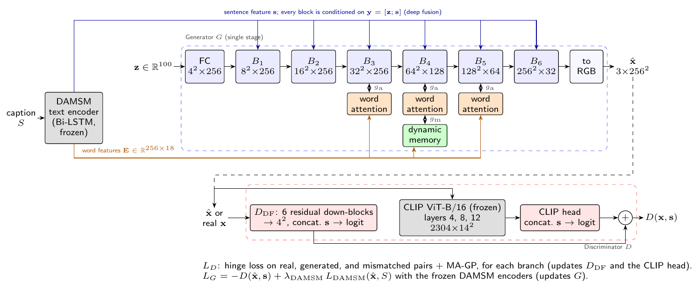

# GAMF-GAN: Gated Attention–Memory Fusion GAN for Text-to-Image Generation

Code, data splits, and results of the study (repository: https://github.com/ayazemine/gamf-gan)

> H. Urcan and E. Ayaz, *GAMF-GAN: A Gated Attention–Memory Fusion Generative Adversarial Network for
> Semantic Alignment and Visual Quality in Text-to-Image Generation* (under review at IEEE Access).

GAMF-GAN is a single-stage text-to-image GAN. It inserts the word-level attention of AttnGAN (at 32, 64,
and 128 px) and the dynamic memory of DM-GAN (at 64 px) into the deep-fusion generator of DF-GAN through
residual branches whose gates are initialized at zero. Its discriminator adds a conditional head on the
features of a frozen CLIP ViT-B/16 image encoder (layers 4, 8, 12) to the DF-GAN discriminator.



## Results (held-out test splits, mean ± std over 3 seeds)

All models were re-implemented in this code base and trained by us under an identical protocol (same
subsets, splits, 256 × 256 px, 120 epochs, batch size 32, checkpoint selection by validation FID).

| Dataset | Model | FID ↓ | KID ×10³ ↓ | CLIP-R@1 (%) ↑ | DAMSM-R@1 (%) ↑ |
|---|---|---|---|---|---|
| CUB-200-2011 | **GAMF-GAN** | **22.7 ± 0.6** | **3.37 ± 0.26** | **17.2 ± 0.6** | 64.5 ± 2.0 |
| | DF-GAN | 35.4 ± 2.8 | 11.09 ± 2.13 | 7.9 ± 0.5 | 15.2 ± 1.3 |
| | AttnGAN | 43.1 ± 7.6 | 15.33 ± 3.67 | 15.5 ± 0.2 | **70.8 ± 0.8** |
| | DM-GAN | 91.8 ± 36.7 | 46.54 ± 25.27 | 13.5 ± 1.8 | 61.5 ± 1.7 |
| | TC-StyleGAN | 205.0 ± 19.6 | 177.47 ± 14.34 | 3.6 ± 0.3 | 10.0 ± 1.8 |
| Oxford-102 Flowers | **GAMF-GAN** | **49.9 ± 1.6** | **15.77 ± 2.10** | **16.9 ± 0.5** | 59.9 ± 1.6 |
| | DF-GAN | 55.2 ± 1.7 | 21.15 ± 0.96 | 10.6 ± 0.5 | 24.0 ± 0.5 |
| | AttnGAN | 67.0 ± 3.3 | 23.98 ± 2.30 | 13.7 ± 0.7 | **62.6 ± 3.7** |
| | DM-GAN | 78.1 ± 3.1 | 30.30 ± 1.60 | 12.5 ± 0.4 | 56.8 ± 0.6 |
| | TC-StyleGAN | 172.8 ± 12.7 | 120.56 ± 7.86 | 4.1 ± 0.3 | 6.0 ± 0.6 |
| MS COCO | **GAMF-GAN** | **63.1 ± 1.6** | **6.19 ± 0.41** | **42.0 ± 2.0** | 65.5 ± 1.0 |
| | AttnGAN | 81.9 ± 0.8 | 13.96 ± 0.56 | 29.7 ± 0.7 | **74.5 ± 0.8** |
| | DM-GAN | 89.0 ± 1.3 | 19.21 ± 0.94 | 23.8 ± 0.2 | 68.9 ± 0.6 |
| | DF-GAN | 101.7 ± 1.8 | 51.32 ± 1.12 | 14.5 ± 0.7 | 23.2 ± 0.3 |
| | TC-StyleGAN | 220.2 ± 22.3 | 106.38 ± 20.75 | 3.7 ± 1.6 | 8.6 ± 4.3 |

All metrics, including IS, CLIPScore, SSIM, LPIPS, LPIPS diversity, and Welch's *t*-tests, are in
[`results/final_test/summary.csv`](results/final_test/summary.csv) and
[`results/final_tables.tex`](results/final_tables.tex); the CUB-200-2011 ablation (without the CLIP branch /
word attention / dynamic memory) is in [`results/final_ablation/summary.csv`](results/final_ablation/summary.csv),
the computational cost in [`results/cost_cub.json`](results/cost_cub.json), and the analysis of the learned gates and word-attention maps (`scripts/branch_analysis.py`) in [`results/branch_analysis/`](results/branch_analysis/).

Please note when interpreting the results (details in the paper):
* The absolute values are **not comparable with published full-benchmark results**: the models are
  trained on subsets (4,000–6,000 images) and evaluated on 950–1,500 test images.
* Most of the improvement comes from the **CLIP branch of the discriminator** (ablation); word attention
  and dynamic memory contribute small, mostly non-significant gains in alignment. The CLIP-based metrics
  use a different CLIP model (ViT-B/32) than the discriminator (ViT-B/16), but may still favor GAMF-GAN.
* AttnGAN has a higher DAMSM-R@1, DF-GAN produces more diverse samples, and GAMF-GAN is the most expensive
  model to train.

### Qualitative examples

`results/figures/` contains the eight figures of the paper under the same file names as in the manuscript
(`fig01_architecture.pdf` … `fig08_coco_failure_cases.jpg`). For MS COCO, Fig. 6 of the paper shows images
generated from three short captions written by the authors (`fig06_coco_comparison.jpg`). Two supplementary
figures are provided for transparency: the comparison on five randomly drawn MS COCO test captions
(`supp_coco_random_test_captions.jpg`) and a first set of author-written captions (“a red bus on the street”,
“a pizza on a table”, “a giraffe standing in the grass”), which was replaced by the set used in the paper
(`supp_coco_first_caption_set.png`).

## Installation

Python 3.12, PyTorch 2.6 (CUDA 12.4); tested on NVIDIA RTX 3090 (24 GB).

```bash
pip install torch torchvision --index-url https://download.pytorch.org/whl/cu124
pip install -r requirements.txt
python scripts/prefetch_weights.py      # Inception-v3, LPIPS, CLIP ViT-B/16 and ViT-B/32
python tests/smoke_test.py --models gamf dfgan   # end-to-end test on a tiny synthetic dataset
```

## Data

```bash
python scripts/download_data.py --datasets cub flowers coco   # -> raw/cub, raw/flowers, raw/coco
python -m gamf.data.prepare --config configs/base.yaml configs/datasets/cub.yaml
```

`gamf.data.prepare` draws the subsets with the fixed seed 2026 (filters: shorter side ≥ 256 px, RGB,
complete caption sets), rejects test images that are near-duplicates of training/validation images
(MD5 and 64-bit dHash, Hamming distance ≤ 4), and audits the splits before any training. The exact image
IDs of every split used in the paper are listed in [`data/splits/`](data/splits/) (`<dataset>_split_ids.csv`,
with the fixed evaluation caption index of each validation/test image), together with the rejection
counts in `split_summary.json`. The captions themselves are not redistributed; they are read from the
original datasets (Reed et al. captions for CUB-200-2011 and Oxford-102 Flowers, COCO 2014 captions).

| | CUB-200-2011 | Oxford-102 Flowers | MS COCO |
|---|---|---|---|
| Training / validation / test images | 5,000 / 300 / 1,200 | 4,000 / 250 / 950 | 6,000 / 300 / 1,500 |
| Test source | unseen classes | unseen classes | `val2014` |

## Training and evaluation

Configurations are merged left to right: `base.yaml`, the dataset, the model (ablations on top of
`gamf.yaml`). The merged configuration is stored in every run directory.

```bash
# DAMSM text/image encoders (once per dataset, frozen afterwards)
python -m gamf.train_damsm --config configs/base.yaml configs/datasets/cub.yaml
# GAMF-GAN, seed 0
python -m gamf.train --config configs/base.yaml configs/datasets/cub.yaml configs/models/gamf.yaml --set seed=0
# ablation: without the CLIP branch
python -m gamf.train --config configs/base.yaml configs/datasets/cub.yaml configs/models/gamf.yaml \
    configs/models/gamf_no_clip.yaml --set seed=0
# test split (after all training runs): 5 images per test caption, all metrics
python -m gamf.sample --run runs/cub/gamf/seed_0 --split test
python -m gamf.evaluate --config runs/cub/gamf/seed_0/config.yaml --gen-dir runs/cub/gamf/seed_0/samples/test \
    --split test --out runs/cub/gamf/seed_0/metrics.json
```

`scripts/run_all.sh` runs the complete study (all datasets, models, seeds, ablations, evaluation, tables).
Baselines: `configs/models/{dfgan,attngan,dmgan,stylegan_t}.yaml`.

Main settings of GAMF-GAN: Adam (β = 0, 0.9), learning rates 1e-4 (G) and 4e-4 (D), hinge loss with
mismatched pairs, matching-aware gradient penalty (k = 2, p = 6) per discriminator branch,
λ_DAMSM = 1, bf16 mixed precision, EMA of the generator weights (0.999), validation FID every 5 epochs.

Pretrained GAMF-GAN weights are not part of this repository.

## Repository structure

```
gamf/                 package: data preparation, models, losses, training, sampling, metrics, analysis
  models/hybrid.py    GAMF-GAN generator and discriminator
  models/dfgan.py     DF-GAN backbone and baseline
  models/generator.py word attention, dynamic memory, AttnGAN/DM-GAN/TC-StyleGAN generators
configs/              base protocol, datasets, models and ablations
scripts/              data download, weight prefetch, full pipeline, tables and figures
tests/smoke_test.py   end-to-end test on synthetic data
data/splits/          image IDs of the train/validation/test subsets used in the paper
results/              test and ablation summaries, cost measurements, figures of the paper
docs/                 architecture diagram (TikZ source and PDF)
```

## License

The code is released under the [MIT License](LICENSE). The datasets (CUB-200-2011, Oxford-102 Flowers,
MS COCO, and the captions of Reed et al.) and the pretrained models used by the code (CLIP, Inception-v3,
LPIPS) are subject to their own licenses and terms of use; they are not part of this repository.
